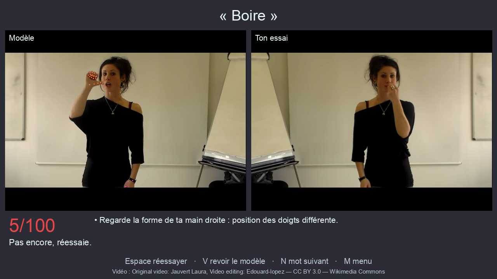
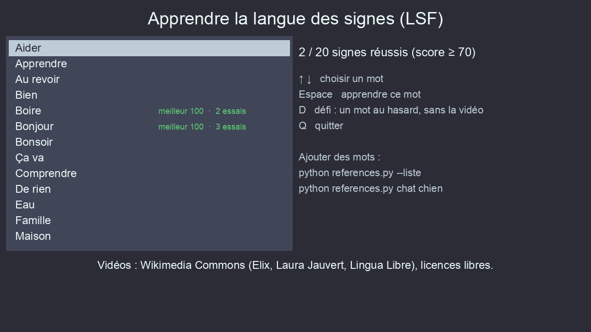

# PyTalk — apprendre et reconnaître la langue des signes française (LSF)

PyTalk filme ta webcam, repère tes mains et ton corps avec [MediaPipe](https://developers.google.com/mediapipe) et propose deux modes :

| Mode | Ce qu'il fait |
|---|---|
| **Apprendre** *(nouveau)* | Tu choisis un mot, une vidéo d'un vrai signeur te montre le signe, tu l'imites devant la caméra, et PyTalk te donne un **score sur 100** et des **conseils** (« monte ta main droite », « regarde la forme de ta main »…). Un mode **défi** te fait réviser les mots sans la vidéo. 756 mots sont disponibles. |
| **Reconnaître** *(d'origine)* | Reconnaît en temps réel 3 signes : *bonjour*, *bonsoir* et *ça va*. |


<sub>Ici, « manger » a été signé à la place de « boire » : le score est mauvais. Vidéos : Laura Jauvert, montage Edouard-lopez, CC BY 3.0, Wikimedia Commons.</sub>

> 🙏 Ce projet est une suite de **[EliotCassidy/PyTalk](https://github.com/EliotCassidy/PyTalk)**, créé par **Eliot CASSIDY et Antonin JOUVE** en 1ère NSI pour les [Trophées NSI](https://trophees-nsi.fr/) 2022, où il a remporté le prix du meilleur projet de 1ère de la région PACA. Toute la base vient d'eux : la détection avec MediaPipe, l'interface et le mode Reconnaître. Merci à eux ! Voir [Remerciements](#remerciements). Code sous licence [GPL v3+](LICENSE).

---

## Sommaire

- [Installation](#installation)
  - [macOS](#macos)
  - [Linux](#linux)
  - [Windows](#windows)
- [Utilisation](#utilisation)
- [Comment ça marche](#comment-ça-marche)
- [Limites](#limites)
- [Dépannage](#dépannage)
- [Structure du projet](#structure-du-projet)
- [Licences et crédits](#licences-et-crédits)
- [Remerciements](#remerciements)

---

## Installation

### Ce qu'il faut

- **Python 3.10, 3.11 ou 3.12.** Python 3.13 et plus récents ne marchent pas : TensorFlow 2.19 et MediaPipe 0.10.21 ne sont pas disponibles pour eux.
- Une **webcam**.
- Environ **2 Go** d'espace disque, surtout pour TensorFlow.
- Une connexion internet au premier lancement du mode Apprendre, pour télécharger les vidéos.

| Système | Mode Apprendre | Mode Reconnaître |
|---|---|---|
| macOS Apple Silicon (M1, M2…) | ✅ | ✅ |
| macOS Intel | ✅ avec `requirements-apprendre.txt` | ❌ TensorFlow 2.19 n'existe pas pour Mac Intel |
| Linux x86_64 | ✅ | ✅ |
| Windows x86_64 | ✅ | ✅ |
| Linux ARM, Windows ARM, Raspberry Pi | ❌ MediaPipe 0.10.21 n'existe pas pour ces processeurs | ❌ |

> **Pourquoi un environnement virtuel ?** Sur macOS (Homebrew) et sur de nombreux Linux, `pip install` hors d'un environnement virtuel est refusé avec l'erreur `externally-managed-environment`. Les commandes ci-dessous créent un dossier `.venv` qui contient toutes les bibliothèques du projet, sans toucher au reste du système.

### Récupérer le projet

```bash
git clone https://github.com/AnthonyMarcelin/pytalk-LSF.git
cd pytalk-LSF
```

Sans git : bouton **Code → Download ZIP** sur GitHub, puis décompresse l'archive.

### macOS

```bash
# 1. Python 3.12 et Tk (pour l'interface graphique)
brew install python@3.12 python-tk@3.12

# 2. Environnement virtuel + bibliothèques (dans le dossier du projet)
python3.12 -m venv .venv
source .venv/bin/activate
pip install -r requirements.txt
#   Mac Intel : pip install -r requirements-apprendre.txt
```

Au premier lancement, macOS demande l'autorisation d'utiliser la caméra pour ton terminal (Terminal, iTerm, Ghostty…). Accepte. Si tu as refusé, réactive-la dans **Réglages Système → Confidentialité et sécurité → Caméra**.

### Linux

**Debian 12, Ubuntu 22.04 / 24.04 et dérivés (Mint, Pop!_OS…)**, dont le Python système est entre 3.10 et 3.12 (vérifie avec `python3 --version`) :

```bash
sudo apt install python3 python3-venv python3-tk
cd pytalk-LSF
python3 -m venv .venv
source .venv/bin/activate
pip install -r requirements.txt
```

**Autres distributions, ou si ton Python est en 3.13+ (Fedora, Arch…)** : le plus simple est [uv](https://docs.astral.sh/uv/). Il télécharge un Python 3.12 qui contient déjà Tk :

```bash
curl -LsSf https://astral.sh/uv/install.sh | sh   # installe uv
cd pytalk-LSF
uv venv --python 3.12 .venv
source .venv/bin/activate
uv pip install -r requirements.txt
```

Si la caméra ne s'ouvre pas, vérifie que ton utilisateur a accès à la vidéo : `ls -l /dev/video*`. Sur certaines distributions, il faut l'ajouter au groupe `video` avec `sudo usermod -aG video $USER`, puis se déconnecter et se reconnecter.

### Windows

1. Installe **Python 3.12** depuis [python.org](https://www.python.org/downloads/windows/) (installateur « Windows installer (64-bit) »). Pendant l'installation :
   - coche **« Add python.exe to PATH »** ;
   - laisse coché **« tcl/tk and IDLE »** (c'est le cas par défaut).
2. Ouvre **PowerShell** dans le dossier du projet :

```powershell
py -3.12 -m venv .venv
.venv\Scripts\Activate.ps1
pip install -r requirements.txt
```

Si PowerShell refuse d'activer l'environnement (« l'exécution de scripts est désactivée »), lance une fois `Set-ExecutionPolicy -Scope CurrentUser RemoteSigned`, ou utilise l'invite de commandes `cmd` avec `.venv\Scripts\activate.bat`.

Si l'installation de MediaPipe ou de TensorFlow se plaint d'une DLL manquante, installe le [Microsoft Visual C++ Redistributable](https://learn.microsoft.com/fr-fr/cpp/windows/latest-supported-vc-redist).

---

## Utilisation

Toutes les commandes se lancent **depuis le dossier `src`**, avec l'environnement virtuel activé :

```bash
cd src
python main.py        # écran d'accueil (boutons « Apprendre la LSF » et « Reconnaitre »)
python apprendre.py   # ou directement le mode Apprendre
```

Si l'environnement n'est pas activé, utilise directement son Python : `../.venv/bin/python main.py` (macOS/Linux) ou `..\.venv\Scripts\python main.py` (Windows).

### Choisir la caméra

PyTalk utilise la caméra n° 0 par défaut. Si tu as plusieurs caméras (iPhone en Continuity Camera, caméra virtuelle OBS, webcam USB…), choisis la bonne avec la variable `PYTALK_CAMERA` :

| Système | Commande |
|---|---|
| macOS / Linux | `PYTALK_CAMERA=1 python main.py` |
| Windows PowerShell | `$env:PYTALK_CAMERA=1; python main.py` |
| Windows cmd | `set PYTALK_CAMERA=1 && python main.py` |

### Mode Apprendre



Au premier lancement, PyTalk télécharge **20 mots de départ** (bonjour, merci, oui, non, pardon, ça va, manger, boire…) depuis Wikimedia Commons et les analyse. Ça prend environ 2 minutes, une seule fois.

**Déroulé d'un exercice :**

1. **Choisis un mot** avec ↑ ↓, puis appuie sur **Espace**.
2. **Regarde le modèle** à gauche : la vidéo tourne en boucle. Certains mots ont plusieurs versions, signées par des personnes différentes ; **A** passe à la suivante.
3. Appuie sur **Espace**. Un compte à rebours de 3 secondes démarre : mets-toi bien en face de la caméra, mains baissées.
4. **Fais le signe** quand le point rouge apparaît, puis **baisse les mains** : l'enregistrement s'arrête tout seul.
5. **Lis ton score et les conseils.** Ton essai est rejoué à côté du modèle pour comparer.

**Touches :**

| Écran | Touche | Action |
|---|---|---|
| Menu | ↑ ↓ (ou P / S) | Choisir un mot |
| | Espace / Entrée | Apprendre ce mot |
| | D | **Défi** : un mot au hasard, sans la vidéo. Les mots mal réussis reviennent plus souvent. |
| | Q / Échap | Quitter |
| Exercice | Espace | Essayer (ou terminer l'enregistrement plus tôt) |
| | A | Autre version du modèle |
| | V | Voir la vidéo (aide en mode défi) |
| | M / Échap | Retour au menu |
| Résultat | Espace / R | Réessayer |
| | V | Revoir le modèle |
| | N | Mot suivant |

Tes meilleurs scores sont enregistrés dans `src/progres.json` et affichés dans le menu. Un mot compte comme réussi à partir de 70/100.

**Gauchers :** ton geste est aussi comparé en miroir, et le meilleur des deux résultats est gardé. Tu peux donc signer avec ta main dominante.

### Ajouter des mots

756 mots sont disponibles sur Wikimedia Commons. Pour les explorer et les ajouter :

```bash
python references.py --liste            # tous les mots disponibles
python references.py --liste cha        # ceux qui commencent par « cha »
python references.py chat chien maison  # télécharger ces mots
python references.py --tout             # tout télécharger (long : ~800 vidéos)
python references.py --credits          # auteurs et licences des vidéos téléchargées
python references.py --rafraichir       # remettre à jour le catalogue
```

Les accents et les majuscules ne comptent pas : `ca va` trouve « Ça va ».

### Mode Reconnaître (d'origine)

Sur l'écran d'accueil, clique sur **Reconnaitre**. Une fenêtre montre la webcam avec les points détectés ; quand l'un des 3 signes appris (*bonjour*, *bonsoir*, *ça va*) dépasse 70 % de probabilité, il s'ajoute dans la bande orange en haut. Appuie sur **Q** pour quitter.

Le modèle `src/action.h5` a été entraîné par les auteurs d'origine sur leurs propres gestes : la reconnaissance est approximative pour une autre personne.

---

## Comment ça marche

### Mode Apprendre

```
 vidéo de référence ──► MediaPipe ──► points des mains + épaules ─┐
 (Wikimedia Commons)                                                ├─► normalisation ─► alignement (DTW) ─► score + conseils
 ta webcam ──────────► MediaPipe ──► points des mains + épaules ─┘
```

1. **Détection** — Pour chaque image, MediaPipe Holistic donne les 21 points de chaque main et la position des épaules (`comparaison.points_image`). Les points des vidéos de référence sont calculés une fois au téléchargement et gardés dans `src/refs/points/`.
2. **Normalisation** (`comparaison.normaliser`) :
   - la **position** de chaque main est mesurée par rapport au centre des épaules, en « largeurs d'épaules ». Ta taille et ta distance à la caméra n'ont donc pas d'importance ;
   - la **forme** de la main (position des doigts) est mesurée par rapport au poignet ;
   - une main **au repos** (posée en bas) est ignorée, et les temps morts au début et à la fin sont coupés.
3. **Alignement temporel** — La [déformation temporelle dynamique (DTW)](https://fr.wikipedia.org/wiki/Déformation_temporelle_dynamique) associe chaque instant de ton geste à l'instant correspondant du modèle. Un geste plus lent ou plus rapide peut donc quand même correspondre.
4. **Score** — Le coût moyen de l'alignement est converti en score de 0 à 100. Le geste est comparé à chaque version du modèle, et aussi en miroir ; le meilleur résultat est gardé.
5. **Conseils** — Le long de l'alignement, PyTalk mesure les écarts : main trop haute ou trop basse, trop écartée ou trop au centre, forme des doigts différente, main manquante, geste trop rapide ou trop lent. Les 3 écarts les plus importants sont affichés.

Le mode Apprendre **n'utilise pas d'intelligence artificielle entraînée** : il n'a pas besoin de TensorFlow, et ajouter un mot revient simplement à ajouter une vidéo de référence.

Les réglages (poids, seuils) sont en tête de `src/comparaison.py`. Ils ont été calibrés en comparant les vidéos de référence entre elles :

| Comparaison | Coût typique | Score |
|---|---|---|
| Même mot, même vidéo | ~0 | 100 |
| Même mot, deux personnes différentes | 0,2 à 0,6 | ~85 à ~25 |
| Deux mots différents | souvent plus de 0,7 | moins de 10 |

### Mode Reconnaître

Un réseau de neurones LSTM (TensorFlow/Keras) reçoit les 20 dernières images (environ 1 seconde) sous forme de 1 662 valeurs par image (corps, visage, mains) et donne une probabilité pour chacun des 3 mots. Il ne cherche un signe que lorsqu'au moins une main est visible.

---

## Limites

- **Ce n'est pas un cours de LSF.** La LSF passe aussi par les expressions du visage, le regard et l'espace autour du corps, que PyTalk n'évalue pas. Utilise-le pour t'entraîner en complément d'un cours ou d'un dictionnaire comme [Elix](https://elix-lsf.fr/).
- **Des signes proches donnent des scores proches.** *Bonjour* et *merci*, par exemple, partent tous les deux du visage vers l'avant : faire l'un à la place de l'autre peut obtenir ~70. Le score mesure à quel point ton mouvement ressemble au modèle, ce n'est pas une certitude.
- **La caméra compte.** Il faut que tes mains et tes épaules soient dans le cadre, avec un bon éclairage. Une main qui sort du cadre est vue comme « absente ».
- **Variantes régionales.** Un même mot peut se signer différemment selon les régions ou les personnes. C'est pour ça que PyTalk compare ton geste à toutes les versions disponibles.
- **Le bouton « Entrainer »** de l'écran d'accueil (code d'origine) lance la reconnaissance, pas l'entraînement. Le script `training.py` d'origine n'est pas fonctionnel en l'état : il entraîne le modèle avant d'avoir enregistré les gestes.

---

## Dépannage

| Problème | Solution |
|---|---|
| `error: externally-managed-environment` | Crée et active l'environnement virtuel (voir [Installation](#installation)) au lieu d'installer avec `pip3` hors environnement. |
| `zsh: command not found: python` | Active l'environnement (`source .venv/bin/activate`) ou utilise `../.venv/bin/python`. |
| `No module named '_tkinter'` | macOS : `brew install python-tk@3.12`. Debian/Ubuntu : `sudo apt install python3-tk`. Windows : relance l'installateur Python et coche « tcl/tk ». |
| `No matching distribution found for tensorflow` / `mediapipe` | Ton Python est trop récent (3.13+) ou ton processeur n'est pas pris en charge. Utilise Python 3.12 (voir le tableau des systèmes). |
| La fenêtre montre une autre caméra (iPhone, caméra virtuelle…) | Change de caméra avec `PYTALK_CAMERA=1` (ou 2…). |
| `OpenCV: not authorized to capture video` (macOS) | Autorise la caméra pour ton terminal dans Réglages Système → Confidentialité et sécurité → Caméra, puis relance. |
| « Caméra indisponible » ou écran noir | Une autre application utilise peut-être la caméra (visio…). Ferme-la, ou essaie un autre numéro de caméra. |
| La fenêtre PyTalk n'apparaît pas | Elle s'est peut-être ouverte derrière le terminal : regarde dans la barre des tâches ou le Dock. |
| `Wikimedia Commons ne répond pas` | Problème de réseau ou trop de requêtes : réessaie dans une minute. |
| Linux : `ImportError: libGL.so.1` | `sudo apt install libgl1 libglib2.0-0` (Debian/Ubuntu). |
| Linux (Wayland) : la fenêtre OpenCV ne s'ouvre pas ou plante | Lance avec `QT_QPA_PLATFORM=xcb python main.py`. |
| Beaucoup de lignes `W0000…` / `I0000…` dans le terminal | Ce sont des journaux internes de TensorFlow et MediaPipe, sans gravité. |

---

## Structure du projet

```
pytalk-LSF/
├── requirements.txt            dépendances complètes (Apprendre + Reconnaître)
├── requirements-apprendre.txt  dépendances du seul mode Apprendre (sans TensorFlow)
└── src/
    ├── main.py          écran d'accueil (Tkinter)
    ├── apprendre.py     mode Apprendre : interface, enregistrement, score
    ├── comparaison.py   normalisation des gestes, DTW, score et conseils
    ├── references.py    catalogue et téléchargement des vidéos LSF (Wikimedia Commons)
    ├── recognition.py   mode Reconnaître (d'origine)
    ├── training.py      entraînement du modèle de reconnaissance (d'origine, non fonctionnel)
    ├── parametre.py     écran « Paramètres » (d'origine)
    ├── action.h5        modèle de reconnaissance entraîné (Keras 2)
    ├── img/, video/     images et vidéo de l'interface
    ├── refs/            (créé au 1er lancement, ignoré par git) vidéos, points, catalogue
    └── progres.json     (créé au 1er essai, ignoré par git) tes scores
```

Les vidéos téléchargées (`src/refs/`) et ta progression (`src/progres.json`) ne sont pas versionnées : chaque installation télécharge ses propres vidéos.

### Choix techniques

- **TensorFlow 2.19 + `tf-keras`** : le modèle `action.h5` a été enregistré avec Keras 2, que Keras 3 ne sait plus lire. `recognition.py` active donc l'ancien Keras (`TF_USE_LEGACY_KERAS=1`).
- **MediaPipe 0.10.21** : c'est la dernière version qui contient l'API `mp.solutions` (Holistic) utilisée par le projet. Les versions suivantes l'ont supprimée.
- **Pillow** sert à écrire du texte avec accents dans les fenêtres OpenCV, qui ne gèrent pas les accents.

---

## Licences et crédits

- **Code** : [GPL v3 ou ultérieure](LICENSE), comme le projet d'origine.
- **Vidéos de référence** : elles ne sont pas incluses dans le dépôt ; elles sont téléchargées depuis la catégorie [Videos of French Sign Language](https://commons.wikimedia.org/wiki/Category:Videos_of_French_Sign_Language) de Wikimedia Commons. L'auteur et la licence de chaque vidéo sont affichés sous la vidéo pendant l'exercice, et listés par `python references.py --credits`. Les principales sources sont :
  - [Elix, le dictionnaire vivant en langue des signes](https://elix-lsf.fr/) (association Signes de sens) — CC BY-SA 4.0 ;
  - Laura Jauvert (montage : Edouard-lopez) — CC BY 3.0 ;
  - les contributeurs et contributrices de [Lingua Libre](https://lingualibre.org/) — CC0 ou CC BY.
- **Captures d'écran** de ce README : elles contiennent des images de vidéos de Laura Jauvert (CC BY 3.0, Wikimedia Commons).
- **Projet d'origine** : [EliotCassidy/PyTalk](https://github.com/EliotCassidy/PyTalk), par Eliot CASSIDY et Antonin JOUVE — GPL v3+.

---

## Remerciements

Un grand merci à **Eliot CASSIDY et Antonin JOUVE**, les auteurs de [PyTalk](https://github.com/EliotCassidy/PyTalk). Sans leur projet, celui-ci n'existerait pas. Ils ont eu l'idée de traduire la langue des signes en temps réel avec une simple webcam. Ils ont construit la détection des mains et du corps avec MediaPipe, entraîné le modèle de reconnaissance et conçu l'interface que ce dépôt réutilise. Ils l'ont fait en classe de 1ère, et leur travail a été récompensé aux Trophées NSI 2022. Leur [vidéo de présentation](https://kodcast.com/w/tiPFati94gUxTJbSivMCnw) vaut le détour.

Merci aussi :
- aux personnes qu'ils remerciaient eux-mêmes : les organisateurs des Trophées NSI, leurs professeurs de NSI et les ami·es qui leur ont fait des retours ;
- à [Elix](https://elix-lsf.fr/), à Laura Jauvert et aux contributeurs et contributrices de [Lingua Libre](https://lingualibre.org/), qui ont publié des vidéos de LSF sous licence libre sur Wikimedia Commons : le mode Apprendre repose entièrement sur leur travail ;
- à l'équipe de [MediaPipe](https://developers.google.com/mediapipe) (Google) pour la détection des mains et du corps.
